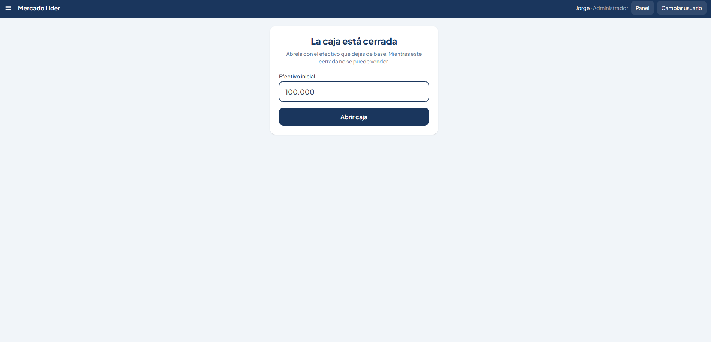
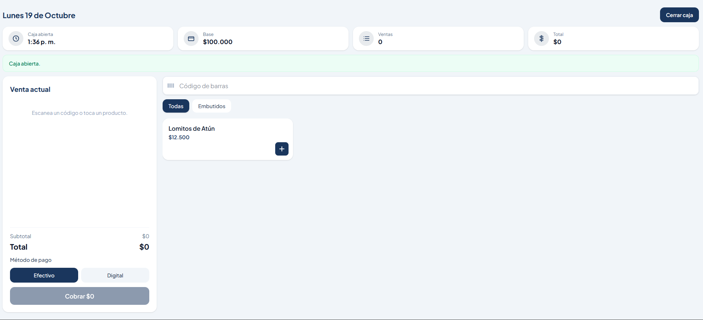
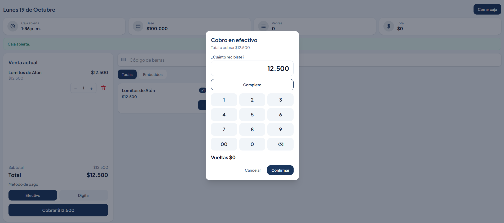
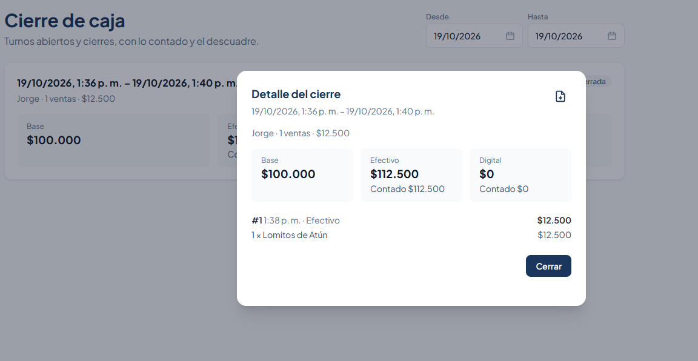

# Cierre de caja — pipeline de Arqueo

Cuando un negocio cierra la caja en Arqueo, este pipeline arma el resumen del turno y se lo envía al correo de la cuenta.

Este repositorio es el proyecto de ingeniería de datos: lee la base, transforma el cierre y entrega un aviso. La app sigue siendo la que abre la caja, cobra y la cierra. El pipeline no reemplaza esa pantalla. Espera a que el turno quede cerrado y avisa al dueño, que no siempre está en el local.

## Qué problema resuelve

El cajero cuenta el dinero y cierra el turno en la app. El dueño se entera por correo, con:

- horario y cajero
- tickets y ventas
- efectivo esperado contra efectivo contado
- digital esperado contra digital contado

Si no hay un cierre nuevo, no sale ningún correo.

## El paso a paso en el local

Estas cuatro pantallas son el turno que después lee el pipeline. El ejemplo es Mercado Lider, el 19 de octubre de 2026: Jorge abre con $100.000, cobra un Lomitos de Atún en efectivo y cierra a la 1:40 p. m.

### 1. Abrir la caja

La caja empieza cerrada. El cajero anota el efectivo que deja de base y pulsa **Abrir caja**. Mientras esté cerrada no se puede vender.

Ese monto queda en `turnos_caja.fondo`. En el ejemplo, el fondo es $100.000.

### 2. La caja queda abierta

Al abrir, el turno queda activo: hora de apertura, base y el total de ventas en cero. Desde aquí se puede escanear o tocar un producto.

### 3. Cobrar una venta

Cada venta cerrada es un pedido. Guarda el turno, el método de pago y el total. Efectivo entra al cajón. Tarjeta, transferencia y digital se cuentan aparte.

En el ejemplo hay un solo ticket: Lomitos de Atún, $12.500, cobrado en efectivo.

### 4. Cerrar la caja

Al cerrar, el cajero cuenta el efectivo y lo digital. La app guarda la hora de cierre y los dos conteos. Ese es el evento que el pipeline espera: un turno con `cerrada_at`.

La pantalla de cierre muestra la base, las ventas y lo contado. El pipeline repite esa misma cuenta en el correo.

## Cómo lo hace el pipeline

GitHub Actions ejecuta `arqueo-cierres` cada 15 minutos y se apaga al terminar.

### Extraer

Lee el Postgres de Supabase, por el Session pooler.

De `turnos_caja` trae los turnos cerrados en los últimos días (`DIAS_ATRAS`, hoy 2). Une el nombre del negocio (`restaurantes`), el cajero (`empleados`) y el correo de la cuenta. El correo sale de `accesos.email`. Si esa fila no existe, usa `auth.users`, que es el de la cuenta con la que entra el cliente.

Después trae los `pedidos` en estado `cerrado` de esos turnos: método de pago y total.

### Transformar

Arma un renglón por cierre, con la misma cuenta que la pantalla:

- efectivo esperado = fondo inicial + ventas en efectivo
- digital esperado = ventas con tarjeta, transferencia o digital
- diferencia = lo contado − lo esperado

En el ejemplo: $100.000 de fondo + $12.500 en efectivo = $112.500 esperados en el cajón. Si el cajero contó eso mismo, la diferencia es $0. Lo digital queda en cero porque esa venta no fue digital. Las horas se muestran en hora de Bogotá.

Si un conteo viene vacío, el correo dice «sin conteo» y no inventa la diferencia.

### Entregar

Descarta los turnos que ya están en `pipeline.cierres_avisados` y los que no tienen un correo válido. Si no queda ninguno, imprime «No hay cierres nuevos.» y no envía nada.

Para cada cierre nuevo arma el asunto `Cierre de caja — {negocio}` y el cuerpo con horario, cajero, tickets y las diferencias. Lo manda por SMTP de Gmail. Después anota el `id_turno` en `pipeline.cierres_avisados`, así la siguiente corrida no lo repite.

Esa tabla vive en Supabase. La crea la primera corrida y no está expuesta en la API. El esquema `pipeline` no lo usa la app.

Con `ENVIAR_CORREO=false` el programa solo imprime el correo: no lo envía y no marca el turno. Si existe la variable `CORREO_PRUEBA`, el aviso va a ese correo y no al de la cuenta. En el uso normal esa variable no está, y el destino es el correo del negocio.

## Dónde corre

El workflow está en `.github/workflows/avisar-cierres.yml`.

La URL de la base y la clave de Gmail son secretos del repositorio. Los días hacia atrás, el SMTP público y si el envío es real son variables. El detalle está en [deploy/github-actions.md](deploy/github-actions.md).
